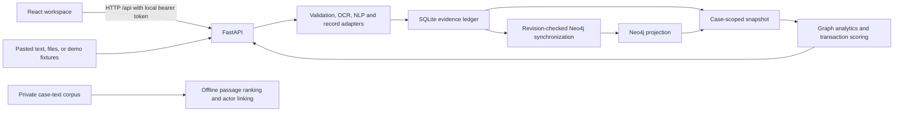

# MAHA system handoff

**Reviewed 21 November 2026** · **Checkout `/opt/MAHA`** · **Baseline `mahalocal` at `5e20840`**

MAHA is a local academic prototype for evidence-linked investigation review. An investigator imports records, examines the original evidence, reviews possible identity matches, explores a case graph, and exports findings with their sources. The product combines deterministic rules, pretrained NLP, graph algorithms, and a descriptive transaction model. The project also contains separate research pipelines and benchmark reports.

## 1. Read this first

- **SQLite owns the evidence.** The ledger retains original source blobs, observations, graph assertions, case grants, and review history. Neo4j is a rebuildable graph projection. It can fall back to SQLite when Neo4j is unavailable or behind.
- **The live dashboard and research models have different entry points.** The dashboard runs pretrained NLP during import and fits an Isolation Forest on transaction groups during case analysis. Our trained organizer-role models run from a standalone command over local documents and do not feed the workspace.
- **Evidence coverage, extraction fidelity, and investigative relevance are different measurements.** A resolvable reference establishes traceability. A replayed locator checks that the stored passage matches the source. Relevance and the interpretation of a source assertion require review.
- **Use current code for behavior and evaluation artifacts for measured results.** The October status report, academic report, and presentation preserve earlier iterations. Some describe composite risk scoring, generated prosecution briefs, configurable model weights, and automated adjudication that have since been replaced or retired. See [historical documents and reconciliation](#14-document-map-and-reconciliation).

## 2. Architecture and request flow



| Layer | Current implementation | Entry point |
| --- | --- | --- |
| Web app | React 19, React Router, Vite, optional Clerk, vis-network and Three.js | [main.jsx](../frontend/src/main.jsx), [Workspace.jsx](../frontend/src/Workspace.jsx) |
| Service | FastAPI under Uvicorn, schema validation with Pydantic | [api.py](../maha/api.py), [cli.py](../maha/cli.py) |
| Evidence, permissions, review | SQLite tables and original file blobs | [store.py](../maha/store.py), [judgment_review.py](../maha/judgment_review.py) |
| Ingestion | Strict structured adapters, PDF text and image OCR, pretrained NLP and explicit rules | [ingestion.py](../maha/ingestion.py), [document_intake.py](../maha/document_intake.py), [nlp.py](../maha/nlp.py), [judgments.py](../maha/judgments.py) |
| Graph and findings | Neo4j or local ledger projection, NetworkX, scikit-learn, evidence-linked dossiers | [graph.py](../maha/graph.py), [analytics.py](../maha/analytics.py), [suspects.py](../maha/suspects.py) |
| Research and verification | Temporal benchmarks, corpus collection and attribution evaluation, backend tests | [benchmark.py](../maha/benchmark.py), [scripts](../scripts/), [tests](../tests/) |

## 3. Run and configure the project

Use two terminals from the repo root for development. The backend CLI reads the root `.env` and binds to loopback. Vite proxies relative `/api` requests to port 8765.

```bash
cd /opt/MAHA
.venv/bin/python -m maha.cli serve
```

```bash
cd /opt/MAHA
npm --prefix frontend run dev -- --port 5173 --strictPort
```

- Open the development workspace at <http://127.0.0.1:5173/app> or the landing page at <http://127.0.0.1:5173/>.
- With `frontend/dist` built, FastAPI also serves the app at <http://127.0.0.1:8765/app>. Its static routing handles direct requests to the landing, workspace, and authentication routes, including nested auth paths. The health endpoint is <http://127.0.0.1:8765/api/health>. A healthy response establishes process availability. Inspect the `backend` field in `/api/graph` to tell which graph store served the request.
- The existing Linux setup previously used transient user services named `maha-backend-8765.service` and `maha-frontend-5173.service`. Check bound ports before starting duplicate processes. Service state is machine-specific.
- Use Python 3.12 for the documented environment. For a clean install, follow [requirements.lock](../requirements.lock) and install the project with `pip install -e .`. For the frontend, use a compatible Node 22 and npm 10 with `npm --prefix frontend ci`. A pnpm lock also exists. The merged install was verified with npm 10 and the existing npm lockfile.
- Put the optional Clerk publishable key in `frontend/.env.local` under `VITE_CLERK_PUBLISHABLE_KEY`. Restart Vite after changing it, and rebuild for the FastAPI-served bundle. Without a key, the app displays local development mode and still requires a MAHA bearer token. Clerk protects entry to the frontend route. The backend independently authorizes the MAHA token and does not derive case permissions from a Clerk session.
- With default paths, the private credentials file is `data/private/runtime/access.json`. Use the intended account entry locally. The original initialization creates separate investigator and restricted accounts. The merged app retains the actual grant list in the SQLite ledger. `maha init` is for a fresh ledger and refuses to overwrite an existing access file.
- `MAHA_DATA` controls the runtime directory. Optional Neo4j configuration is in [.env.example](../.env.example) and [compose.yaml](../compose.yaml). Docker Compose maps ports 7474 and 7687 to loopback. Use a separate Neo4j database for each ledger because synchronization replaces the MAHA projection.

Operational checks and build commands:

```bash
npm --prefix frontend run build
.venv/bin/python -m pytest -q
.venv/bin/python -m maha.cli doctor
```

For isolated tests, point `MAHA_DATA` at a temporary directory. The two live Neo4j tests require `MAHA_NEO4J_TEST=1` and a running, seeded, synchronized Neo4j environment. The repo contains an example settings file and locks. Original benchmark datasets, credentials, weights obtained outside the package lock, and runtime evidence need separate setup. Keep `.env`, ignored runtime files, and original case files out of commits and handoff messages.

## 4. Data intake and provenance

| Input | Current path | What lands in the ledger |
| --- | --- | --- |
| IBM HI-Small format CSV | Import records or demo seed, positional 11-column adapter | Original row fields and line range, namespaced accounts, transaction node, directional legs and shortcut edge. The adapter preserves leading zeros, uses decimal amounts, maps currency, and labels its assumed UTC basis. |
| Synthetic narrative JSON | Structured narrative adapter | Tagged synthetic document records, extracted spans, and explicit template-backed relations. The upload checks the declared case and normalizes the document case to the selected case. The blob retained by this path is the normalized JSON. |
| Synthetic CDR CSV | Structured CDR adapter | Present caller/callee IDs, offset-bearing event time, duration, and call evidence. Identifiers come from the fixture, so this path does not infer phone subscribers. |
| Synthetic case-history CSV | Structured history adapter | Person-to-case assertion, date, source-record status, and supporting text. Status preserves what the record says. |
| Fixed-layout statement PDF | MAHA-DEMO-STATEMENT v1 adapter | Rows for the supported ruled table layout, with page, table, row, and bounding box. Uses pdfplumber. Commercial PDF and spreadsheet statement ingestion require additional adapters. |
| Pasted English FIR or general text | `POST /api/import/raw-text/{case}` | A source excerpt and general named entities as evidence-only observations. |
| English Indian judgment text | Judgment text upload or pasted judgment | Legal named entities, extracted character offsets, labels, model version, and review context. |
| English FIR or judgment PDF/JPEG/PNG | Document upload | Extracted passages, OCR or embedded-text method, page index, extracted-text checksum, character offsets and original blob. The evidence drawer can render the original page and download the source. |

The document importer uses embedded PDF text when usable and Tesseract English OCR when it needs to recover text from an image. It checks input shape and size and bounds OCR subprocess time. The fallback Tesseract runtime, when installed on this host, lives under `data/private/ocr-runtime/`. OCR-derived offsets address extracted text on the page. They do not address bytes in the PDF or coordinates on the image. Printed English was exercised on synthetic inputs. A multilingual, handwritten or noisy-scan accuracy benchmark has not been established. PDF or spreadsheet CDR tables and arbitrary bank statements remain outside the implemented import formats.

The store hashes source bytes for a stable source ID. An evidence ID also incorporates dataset, case, locator and extraction version. Facts carry evidence IDs, case, namespace, and synthetic status. Stable identifiers, row locators and repeated-import checks preserve provenance. An identical re-import recognizes existing observations. Similar CSV records can be retained with a duplicate warning. Bad rows can be quarantined with a reason. A resource-limit failure rolls back the source import. New document-text mentions are review evidence and do not automatically create relationships.

Primary references [data contracts](design/02-data-contracts.md), [source inspection](design/06-sample-inspection.md), [graph and evidence design](design/03-graph-and-evidence.md), and [document intake README](../README.md#fir-and-judgment-document-intake).

## 5. Evidence, review and access

| Concern | Current behavior |
| --- | --- |
| Case grants | The bearer token maps to a local account in SQLite using a stored token hash. The API scopes reads and writes by grants. Creating a case grants the creator the new case. A case ID that belongs to someone else cannot be claimed through the create endpoint. |
| Source access | Evidence records are case-scoped. A raw blob shared across cases requires access to every referencing case. Page rendering retrieves that same protected blob. The workspace uses the token in memory and clears it on lock. |
| Provenance audit | `GET /api/evidence/audit` samples authorized records, checks source checksums, and matches locators to CSV records, decoded text, table extraction, or replayed document pages. Unrepeatable or unsupported checks can be marked unverified. The fidelity rate covers records that could be judged. |
| Judgment review | Reviewers approve, correct, or reject a legal mention with a reason. Corrections must come from the stored source excerpt and use a supported label. The write checks the previous review ID and returns a conflict when stale. Original extraction remains alongside review history. |
| Identity decisions | Candidate reviews capture accepted, rejected, and revoked states with actor, reason, scope and history. Accepted decisions affect the graph projection. Original assertions remain available. |
| Lead review | Relevant, not relevant, and insufficient evidence are manual review states. Review history is retained. Analysis suppresses legacy automated judgments and skips leads whose source evidence cannot be resolved. |
| Export | Report and dossier endpoints return JSON, source links and matching evidence for authorized scope. Dossiers use source roles, related records, accounts, calls and findings where present. The former charge-sheet endpoint returns 410. |

The source and review ledger can be modified by a user with filesystem access. Its hashes and review events support reproducibility. Strong tamper evidence, per-action roles, credential administration, encrypted backups, independent audit controls, and retention drills are deployment gaps.

Case closure and purge are operator actions. The designed schedule is 30 days after case closure for managed case evidence and 90 days for audit entries. The implementation deletes evidence and prunes orphan sources and generated copies. Before use on operational material, verify complete cleanup of modern judgment review and lead review event tables, training metadata, case grants, and external backups. Current `purge()` explicitly enumerates tables and does not cover every newer case-scoped table. Case reset and case purge are different paths. See [store.py](../maha/store.py) and [production readiness](production-readiness.md).

## 6. Graph, resolution and analytics

**Graph construction.** Person, Account, Transaction, Case, Location, Organization and Document nodes appear according to adapter output. Edges include ownership, transaction legs, direct account-transfer shortcuts, communications, case involvement, location and source mentions. Graph objects preserve constituent assertions rather than choosing one asserted role as universal. Account identity is namespaced by source and bank. Explicit IDs support durable identity, while unresolved names begin as mentions.

**Neo4j synchronization.** Graph revisions advance on committed fact and evidence mutations. A background worker reconciles the ledger ID and revision with Neo4j, retries failures, and atomically replaces its projection. A snapshot reads Neo4j only when revisions match and checks them again after the read. Otherwise it uses scoped SQLite facts. Accepted identity matches are applied in the snapshot. The Neo4j replacement is global to the ledger. It remains a scaling limit, and the cross-process file lock uses `fcntl` where available.

**Resolution.** `candidates()` compares normalized person names using SequenceMatcher, with a default similarity threshold of 0.9 and a configured pair budget. Distinct authoritative IDs block candidate generation. Acceptance checks the two connected components for conflicting IDs, including indirect bridges. Candidate generation needs better blocking and real labeled pairs. Acceptance should be tested under concurrent requests because the component check precedes the decision write.

| Output | Basis and limits |
| --- | --- |
| Connections | An entity may occur in multiple authorized cases through explicit case edges. The active case in the main workspace scopes that request to one case. Account-wide calls can yield cross-case findings when permitted. |
| Centrality and community | NetworkX over a simple structural graph. Documents, self-loops and the duplicate direct transaction shortcut are excluded. Degree and Louvain use the unweighted undirected projection. PageRank uses the directed projection. Betweenness samples up to 100 nodes with seed 42. Graph position depends on observed coverage. |
| Fund flow | Traverses account transfers with increasing timestamps, consistent time basis, and matching payment and receiving currencies. Paths have a four-hop default, a 50-result cap and a 20,000-edge search budget. The response carries evidence and a truncation flag. The endpoint can trace cycles or a specified destination. A path is a candidate route. It does not establish that the same funds traversed every edge. |
| Transaction anomalies | Isolation Forest fits and scores the in-scope rows grouped by dataset and payment currency, using `log1p(amount_paid)` and hour of day. Each group requires at least eight transactions. The dashboard shows up to five ranked results per group. This is in-sample descriptive scoring with no validated alert threshold. |
| Person dossiers | Sources for recorded roles, accounts, case records, calls and related findings. The UI groups witnesses and other people. Dossiers are review artifacts. `/api/suspects` is the retained endpoint name. |
| Copilot | Case-scoped lookup for names or authoritative IDs in existing dossiers, with evidence IDs. It uses deterministic matching. There is no language model or external inference service behind this endpoint. |

Sources [graph implementation](../maha/graph.py), [analytics](../maha/analytics.py), [dossiers](../maha/suspects.py), and [case endpoints](../maha/api.py).

## 7. Models and where the data lives

| Model or subsystem | Training data and storage | Runtime use |
| --- | --- | --- |
| `en_core_web_sm` 3.8.0 | Pretrained spaCy package, installed inside `.venv`. Its metadata lists OntoNotes 5 among its sources. | General English entities for narrative and FIR intake. Explicit rules add certain relations for supported synthetic templates. |
| `en_legal_ner_sm` 3.2.0 | Pretrained OpenNyAI model trained on InLegalNER. Local compatible serialization under `data/private/models/en_legal_ner_sm-3.2.0-spacy-3.8.16/`; the loader accepts `MAHA_LEGAL_MODEL`. MAHA evaluated the publisher's test split and reserialized the model for compatibility without fine-tuning it. | Legal entities such as judge, party, witness, statute and provision in English Indian judgments. Reviewers can correct results. [Local evaluation](evaluation/inlegalner.md) |
| Live Isolation Forest | Fits the currently selected transaction group in memory. No persistent weights. Imported IBM-format data can contribute when present in scope. | Transaction anomaly ranking during analysis. |
| Elliptic Random Forest and Isolation Forest | Trained and scored in a standalone benchmark using the temporal split and 93 local features. Output is evaluation metadata. | Benchmarks, outside live case scoring. |
| IBM benchmark Isolation Forest | Separate synthetic temporal experiment over a seeded reservoir of the full IBM HI-Small CSV. | Benchmarks, outside live case scoring. |
| MAHA organizer passage ranker | Logistic regression with TF-IDF/query and position features. Uses labeled development material from 21 cases in the private corpus. | Finds passages that may support organizer roles. The CLI fits it in memory. |
| MAHA organizer actor linker | Logistic regression over candidate features plus source-local rules. The observed development fit uses 22 reviewed candidate examples, including 15 positives. | Proposes a person for an explicit organizer statement with source excerpts. The CLI fits it in memory. |

**Run case analysis** computes live analytics and stores an analysis-run record with timestamp and counts. It does not fine-tune NLP, use the organizer research models, or serialize model weights. The old request schema retains tuning fields that the current endpoint does not apply. The completion flag is stored in `training_runs`. Per-import invalidation should be verified before treating a stored run as a release-grade snapshot of the case.

### Organizer research workflow

1. `collect_case_text.py` retrieves allowlisted primary sources and selected narrative or news sources, retains originals and extracted units, and records hashes and case identifiers. `discover_court_cases.py` screens archive metadata.
2. `prepare_case_roles.py` verifies source anchors and compiles labeled development and evaluation examples. The manifests and fixtures live in [docs/evaluation](evaluation/). The private corpus contains the collected 129 documents, including court opinions, agency reports, news, historical narratives and public-domain fiction.
3. `train_case_passage_ranker.py` and `train_case_actor_linker.py` fit separate models. Unlabeled background units act as weak ranking negatives, while actor supervision uses reviewed candidate sentences. Historical and fiction transfer experiments are explicitly separate.
4. `case_document_attribution.py` is shared by the document evaluator and the prediction CLI. Companion modules handle patterns such as an agency's report of a guilty plea, a named sentencing identity in a nearby paragraph, or a news report quoting a judge. Provenance can span several source units. The evaluator checks case-group overlap between training and held-out fixtures and verifies source hashes.
5. `predict_case_document.py` accepts local UTF-8 text or extracted JSONL. Outputs include the file hash, ranked locations, candidate names, supporting passages, and unreviewed status. It is an offline command. The user interface does not call it.

```bash
.venv/bin/python scripts/predict_case_document.py /path/to/document.txt \
  --source-kind agency_report
```

See [the complete corpus record](evaluation/case-text-corpus.md) for fixtures, source stages, known false positives and misses, transfer experiments, and reproducible evaluation commands.

## 8. Frontend and API map

- `main.jsx` declares `/`, `/app`, `/sign-in`, and `/sign-up`. `auth.jsx` provides an optional Clerk gate and the development fallback. `pages/` implements the public landing and auth UI. `landing.css` and `style.css` cover those surfaces and the workspace.
- `Workspace.jsx` owns the local token, active case, graph and analysis state, tab content, export and intake. Session and case requests can be aborted. Evidence selection cancels the preceding request and clears the drawer on scope changes. Some tab components also exist separately. Trace the JSX entry point before editing a tab because the workspace still renders several panels inline.
- **Overview**, **Connections**, **Flagged behavior**, and **Dossiers** expose summaries, separate analysis queues, and sourced person records. **Graph explorer** offers the lazy-loaded Three.js network and the vis-network 2D map. Visual layouts help navigation. Their positions do not replace computed metrics.
- **Resolution**, **Timeline**, **Import records**, **Quality**, **Audit**, and **Benchmarks** cover identity decisions, events, imports, source review, activity history and separate research reports. `SourcePage.jsx` loads the protected preview. `JudgmentReview.jsx` manages review, excerpt selection and correction history.
- The evidence drawer moves focus when opened, supports Escape with focus inside it, and restores focus on explicit close. The import form tracks the active case. A user with no assigned case can create the first case without a default request to another case.

| API family | Routes and scope |
| --- | --- |
| Bootstrap | `GET /api/health`, `GET /api/me`, `GET/POST /api/cases`; health is public, case data requires the local token. |
| Intake and analysis actions | `/api/import/{kind}/{case_id}`, `/api/import/raw-text/{case_id}`, `/api/cases/{case_id}/{reset,load-sample,train}`; explicit case grant required. |
| Graph and result reads | `/api/{graph,analysis,suspects,timeline,quality,audit}`; use `?case=...` for one case. `/api/flow` uses authorized graph scope with optional end entity. |
| Evidence | `/api/evidence/{id}`, its `source-page` and `judgment-review` subpaths, `/api/evidence/audit`, and `/api/source/{id}`. |
| Identity and leads | `/api/candidates`, `/api/candidates/{id}`, `/api/leads/{id}/review` and `/history`. Resolution considers all authorized cases. |
| Reports and utilities | `/api/report`, `/api/dossier/{id}`, `/api/copilot`, `/api/templates`, `/api/benchmarks`, `/api/doctor`. The charge-sheet and automated adjudication routes return 410. |

## 9. Which datasets prove what

| Source | Verified result | Interpretation |
| --- | --- | --- |
| **Elliptic Bitcoin** | 203,769 transactions and 234,355 edges. Chronological train/validation/test steps 1–29 / 30–34 / 35–49, with unknown labels excluded from supervised metrics. Random Forest test P/R/F1/AP 0.9005/0.7018/0.7888/0.7824. Isolation Forest 0.0651/1.0000/0.1223/0.0386. | Transaction classification benchmark. The Isolation Forest threshold flags nearly the entire test set. Neither experiment validates identity links or MAHA's live model. [Report](evaluation/elliptic-evaluation.json) |
| **IBM HI-Small** | Full profile 5,078,345 synthetic rows. Seeded 50,000-record sample, split by time with ties kept together. Test precision 0.001775, recall 0.11765, AP 0.001764 with 17 test positives. | Separate illustrative transaction baseline. Demo prefix imports and hand-authored ownership/cycle controls have their own provenance. [Profile](evaluation/ibm-profile.json) · [Evaluation](evaluation/ibm-evaluation.json) |
| **Synthetic investigations** | Demo seeding, compact extraction fixtures, two additional sample packs, authorization controls, reversible identity decisions and cycle checks. | Tests testable behavior. Prior NER results on tiny or authored fixtures are not representative FIR or legal-text accuracy. [Demo evaluation](evaluation/demo-evaluation.json) · [NLP evaluation](evaluation/nlp-evaluation.json) |
| **Montagna** | Projected meetings 95 nodes/248 ties and phone 94/120, with 46 shared nodes. Louvain clan ARI 0.410 and 0.370 on the labeled subsets. Boss ranks were mixed. | Small, anonymized structural sanity check against recorded roles. Results depend on the projection and observed network. [Benchmark notes](evaluation/montagna.md) |
| **ICIJ Offshore Leaks** | Full archive scan counted 814,344 entity rows, 771,315 officer rows and 3,339,267 relationship rows. The local benchmark sampled 22,989 nodes and 3,389 edges. It reported 104 exact-normalized collision groups and roughly 5.14 million candidate pairs. | Collision and graph workload research. No criminality labels. The ignored report is `artifacts/evaluation/icij-benchmark.json`. Preserve ICIJ attribution and respect the database/content terms. |
| **InLegalNER** | 4,501 test records. Local legal exact span-and-label micro F1 0.740. For the five selected legal person roles, pooled exact-span F1 was 0.839 legal vs 0.308 generic. | Evaluation of pretrained models on annotated Indian judgment text. No new FIR or organization/phone/account-link evaluation follows from this score. [Protocol and model provenance](evaluation/inlegalner.md) |
| **Case-text organizer corpus** | Latest pooled top-ten regression covers 59 documents from 56 case groups. Relevant passages cover all 44 curated links, with 34 recovered by the hybrid linker, 7 candidate-generation misses and 3 filtering misses. | These were previously reviewed cases, including examples that informed new rules. The labels are curated excerpts. The result does not establish generalization to a new case corpus. [Regression documentation](evaluation/case-text-corpus.md#pooled-document-regression) |

AP is average precision. Keep independent human Precision@K unreported until a frozen sample has been reviewed. The CLI and API retired automated adjudication. The evidence audit is a locator and passage comparison, with its own denominator and unverified count. It does not substitute for independent relevance labels.

### Benchmark reproduction

Run from the repository root with the original dataset files installed. Use the committed reports to inspect existing results without rerunning large jobs. These commands write detailed artifacts locally.

```bash
.venv/bin/python -m maha.cli profile-ibm data/raw/HI-Small_Trans.csv
.venv/bin/python -m maha.cli evaluate --elliptic data/raw/elliptic
.venv/bin/python -m maha.cli evaluate-ibm data/raw/HI-Small_Trans.csv
.venv/bin/python -m maha.cli evaluate-demo
.venv/bin/python -m maha.cli evaluate-nlp
```

The [Montagna instructions](evaluation/montagna.md) and [InLegalNER instructions](evaluation/inlegalner.md) cover their dedicated commands and inputs. `maha.icij_benchmark` accepts the downloaded ICIJ archive and a bounded sample size. Check its Neo4j configuration and use an isolated instance for graph benchmark work. The [role corpus record](evaluation/case-text-corpus.md#reproduce-the-curated-collection) includes the separate collection, labeling and evaluation commands.

## 10. Storage and resource limits

| Location or limit | Meaning |
| --- | --- |
| `/opt/MAHA`, `/home/nj/MAHA` | Main project on the root partition, plus an earlier compatibility symlink for installed runtime paths. The local Python environment and Docker Desktop may still depend on directories under home. |
| `data/private/runtime/` | Default ledger, access file, managed example sources and runtime state. |
| `data/private/models/`, `data/private/ocr-runtime/` | Legal NLP artifact and optional host OCR support. |
| `data/private/case-corpus/` | Originals, extracted source units, manifests, labels, and local role-evaluation outputs. |
| `data/raw/`, `artifacts/evaluation/` | Source dataset archives and detailed local reports. Git-tracked compact benchmark summaries live under `docs/evaluation/`. |
| Upload and document budgets | 25 MiB raw upload, 20 pages, 20 megapixels per OCR image, 100,000 extracted characters and a 90-second document deadline. A raw pasted text request has its own 50,000-character schema limit. OCR uses a bounded worker slot. |
| Interactive defaults | `MAHA_MAX_IMPORT_RECORDS=5000`, `MAHA_MAX_GRAPH_FACTS=20000`, `MAHA_MAX_GRAPH_NODES=2000`, `MAHA_MAX_CANDIDATE_PAIRS=20000`. Oversized operations can return HTTP 413. Flow limits are separate and can return a flagged truncated result. |

The benchmark loader can read Elliptic CSVs directly from the ZIP and stream its provenance index to compressed JSONL. Model fitting still takes memory. Full data profiling and benchmark evaluation are separate from interactive graph size. Previous storage work checked hashes before cleaning duplicates. The earlier disk figures are historical. See [local resource budgets](resource-management.md), [implementation decisions](implementation-notes.md), and [run manifest](evaluation/run-manifest.json).

## 11. Verification and release boundaries

- **Current review** ran the backend suite with an isolated temporary ledger. **36 passed, 2 skipped.** The skipped cases require live Neo4j. The suite exercises imports, source scoping, reversible identities, limits, lead and judgment review, evidence audits, report behavior and simulated projection recovery. Upstream test-tool deprecation warnings remain.
- **Current review** rebuilt the merged frontend with the installed lockfile dependencies. **Build passed**, with React Router directive warnings and chunk-size advisories for the graph dependencies. The largest chunk was about 1,014 kB minified and 271 kB gzipped.
- **Historical merged-browser check** used a temporary ledger to exercise the landing page, local token sign-in, no-case accounts, stale-request cancellation, FIR PDF preview and original download, and 2D/3D graph switching. Earlier browser checks also covered case switching, case-scoped export, keyboard focus and judgment approval. These tests used synthetic evidence and do not verify live Clerk sign-in.
- **Historical OCR smoke** exercised Tesseract on a synthetic FIR PNG and an image-only PDF and verified text and page preview. Large, multilingual or poor-quality scan performance is open.
- **Historical Neo4j test** passed live parity in an earlier checkout. Latest suite skipped both live tests. Simulated recovery and the local-ledger fallback were exercised in later work. Current Neo4j parity, live rollback and recovery need re-verification.
- **Git context** is local `mahalocal` at `5e20840` and includes the merged UI. Use Git to check the current remote default branch before publishing or basing new work on it.

## 12. Priorities and explicit acceptance checks

| Priority | Work | Acceptance check |
| --- | --- | --- |
| Case access and lifecycle | Define per-action roles, explicit grants and revocation, secure credential lifecycle and backup/restore. Audit reset and purge for newer metadata and shared sources. | Exercise two isolated accounts and cross-case sources, rejected operations under a restricted role, complete purge, and restoration from an approved encrypted backup. |
| Ingestion coverage | Add controlled layouts for CDRs and bank statements, preserve original bytes alongside any normalized version, publish mapping and quarantine reasons. | Test representative format families with hand-checked fields and row/page locators. Review OCR and table errors separately. |
| NLP and organizer workflow | Measure errors on fresh judgments, FIRs and unseen case groups, then decide whether to integrate organizer candidates into review. | Freeze sources and labels before tuning. Show exact cited spans and distinguish reported claims, admissions, and findings. Keep assertions reviewable and record decisions. |
| Graph and identity | Test concurrent identity decisions and Neo4j recovery at scale. Consider indexed candidate blocks and incremental projection updates. | Assert no conflicting IDs can merge, verify revision parity during concurrent writes and restarts, and measure projection and query time under representative load. |
| Analytics and benchmarks | Separate descriptive anomalies from calibrated alerts, confirm time and currency handling, and collect independent finding relevance. | Freeze chronological validation/test partitions, demonstrate negative controls and truncation visibility, and publish Precision@K only after complete human review of the chosen window. |
| Frontend and deployment | Make browser regression coverage repeatable, confirm Clerk with authorized test configuration, test the graph with unavailable WebGL and review large bundles. | Reproduce install, build and end-to-end checks on a clean machine, with both local and configured auth. Confirm direct routes, access denials, case context and export behavior. |

## 13. Resuming as the next agent

1. Start in `/opt/MAHA`. Read `git status --short --branch` and `git log -5 --oneline`. Compare the current branch with the baseline in this handoff. Inspect any local changes before modifying files.
2. Identify whether the task concerns the live workspace, a separate benchmark, or organizer research. Use the entry points above. Keep datasets and interpretation boundaries explicit when sharing results.
3. Use an isolated `MAHA_DATA` ledger for tests and fixtures. Start the real app against the existing ledger only when the operator requests it. Keep temporary services on separate ports when the workspace is active.
4. For source or review work, trace adapter → `Store.import_records` → evidence endpoint → workspace drawer. For graph work, trace scope → `snapshot` → projection → `analyze` → report. For organizer research, start with the corpus manifest and preserve case-level splits.
5. Record what verification actually covered, including skipped live Neo4j and Clerk checks. Run the frontend build and backend tests when touching affected modules. Do not infer feature coverage from a successful build alone.

## 14. Document map and reconciliation

| Existing material | How to use it |
| --- | --- |
| [README](../README.md) | Setup, demo commands and later document-intake instructions. Its older architecture paragraph describes fixed-layout PDF only. The appended OCR section and current adapter describe the merged behavior. The setup example has a `ppnpm` typo. |
| [Project handoff v2](reference/project-handoff-v2.md) | Original intent and scope, dataset boundaries, milestones, evaluation and protection requirements. |
| [Week 0](design/00-review-status.md) · [Demo script](design/01-demo.md) · [Delivery backlog](design/05-delivery.md) | Early review decisions, demo acceptance criteria and intended delivery sequence. Backlog completion must be checked against evidence. |
| [Data contracts](design/02-data-contracts.md) · [Sample inspection](design/06-sample-inspection.md) | Physical source mappings and representative intake checks. Full IBM and Elliptic measurements were recorded later. |
| [Graph and evidence](design/03-graph-and-evidence.md) · [Evaluation protocol](design/04-evaluation.md) | Conceptual graph schema, provenance envelope and test design. Use current schema and committed results for implementation details. |
| [Implementation notes](implementation-notes.md) · [Resource management](resource-management.md) | Scope decisions, storage migration, operating limits and source manifests. Older all-case UI and format statements predate the active-case picker and OCR. |
| [September verification](verification.md) · [Production readiness](production-readiness.md) | Earlier engineering/results baseline and subsequent remediation. The counts reflect each document's checkpoint. |
| [October status](../PROJECT_STATUS_AND_PENDING.md) · [Academic report](academic-report.md) · [Presentation deck](presentation-deck.md) · [Presentation outline](presentation-outline.md) | Project history and presentation material. Retire claims of calibrated person risk, auto-generated prosecution briefs, automated investigator precision or operational readiness. The current code exposes reviewable evidence and descriptive analyses. |
| [InLegalNER](evaluation/inlegalner.md) · [Montagna](evaluation/montagna.md) · [Case-text corpus](evaluation/case-text-corpus.md) | Detailed source attribution, benchmark methods, research limitations and reproduction commands. |
| [Synthetic pack 1](../data/sample_datasets/README.md) · [Synthetic pack 2](../data/sample_datasets_2/README.md) | Authored demo cases and file examples. Use the current UI adapters as the authority for accepted fields and formats. |
